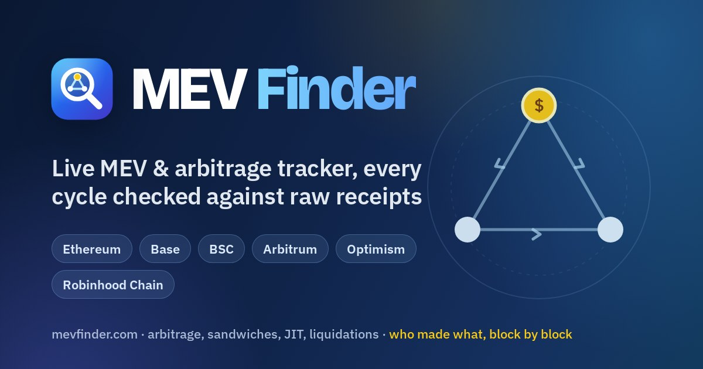
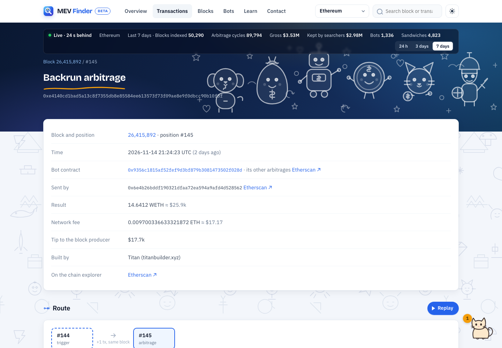
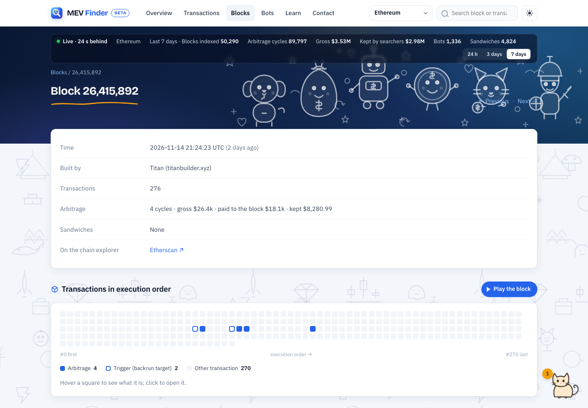

<a href="https://mevfinder.com"></a>

<div align="center">

**MEV Finder watches six blockchains block by block and shows every arbitrage: who made it, how, and what they kept.**

<a href="https://mevfinder.com"></a>
<a href="https://github.com/HarshMPareek/mevfinder/issues/new"></a>
<a href="CONTRIBUTING.md"></a>

[](LICENSE)

</div>

## 🎮 Try it in 30 seconds

1. **Watch a trade happen.** Open [this arbitrage](https://mevfinder.com/ethereum/tx/0xe4140cd1bad5a13c8f7355db8e85584ee613573f73f09ae8e9f0dbcc90b10f3f) and press **▶ Replay**: the bot's coins move through each pool, step by step.
2. **Play a whole block.** Open [a block](https://mevfinder.com/ethereum/block/26415892) and press **Play the block**: 276 transactions in the order they ran, the arbitrage lighting up.
3. **Find the cat.** 🐱 Bottom right of every page. Click it for *Kitty Run*.

<table>
<tr>
<td width="50%"></td>
<td width="50%"></td>
</tr>
</table>

## 🔍 How it works

| | |
|:-:|---|
| 📦 | **A block arrives.** A follower per chain reads every transaction, its receipt and its call trace. |
| 🔁 | **Find the loops.** Swaps that start and end in the same coin, through two or more pools, are candidates. |
| 🕵️ | **Check the trace.** A candidate counts only if the call trace shows the bot itself ran the loop and kept a gain, exact to the last unit. Order fills, rebalances, loans and exploits are thrown out. |
| 💸 | **Follow the money.** What the bot paid the block's builder, what it paid in fees, what it kept. |

Every rule, and the transaction that taught it: [docs/METHOD.md](docs/METHOD.md).

## 🧩 Spot the arbitrage

Same coins in, more coins out. But is it arbitrage? Click to check.

<details>
<summary><b>1.</b> A bot swaps 1,000 USDC → WETH on pool A, then WETH → 1,012 USDC on pool B, in one transaction.</summary>

✅ **Arbitrage.** A closed loop in one coin through two pools the bot called itself, +12 USDC. MEV Finder counts it, then subtracts the fee and the builder's tip.
</details>

<details>
<summary><b>2.</b> A solver fills your order: it takes your 1,000 USDC, gives you 0.33 WETH, and keeps 5 USDC.</summary>

❌ **Order fill.** The 5 USDC is the solver's margin on *your* order, not a loop of its own. Never counted.
</details>

<details>
<summary><b>3.</b> A bot buys and sells on the same pool and ends up 2 USDC richer.</summary>

❌ **Round trip.** One pool both ways is not a price difference between venues. Never counted.
</details>

<details>
<summary><b>4.</b> A vault pulls its liquidity out of a pool, swaps, and puts it back.</summary>

❌ **Rebalance.** The pool's own liquidity moved in the same transaction: a position change, not arbitrage.
</details>

## 🚀 Run it yourself

```sh
git clone https://github.com/HarshMPareek/mevfinder.git && cd mevfinder
uv sync                                      # then put an RPC URL in .env, e.g. ETH_HTTP_URL=…
./arb -c ethereum scan 26149000-26149010     # classify ten blocks
./arb ui                                     # see them at http://127.0.0.1:8787
```

<details>
<summary>More commands</summary>

```sh
./arb -c base tx 0x…                  # one transaction with its whole block
./arb -c ethereum follow              # classify every new block, forever
./arb -c ethereum live-status         # how far behind, any gaps
./arb --help                          # everything
```
All commands and fields: [docs/REFERENCE.md](docs/REFERENCE.md)
</details>

<details>
<summary>What's inside</summary>

```
mevlab/    the classifier: decode → receipt → trace → block
arbkit/    the app: chain · scan · value · live · site · verify · cli
chains/    one folder per chain (Ethereum, Base, BSC, Arbitrum, OP, Robinhood)
ui/        the website (plain JS and CSS)
content/   Learn articles
tests/     offline tests on recorded transactions
```
The full map: [docs/ARCHITECTURE.md](docs/ARCHITECTURE.md)
</details>

## 🤝 Help out

| You can | Here |
|---|---|
| 🐞 Report a wrong label | [open an issue](https://github.com/HarshMPareek/mevfinder/issues/new) with the link |
| 🏊 Add a missing pool or token | [tell us](https://github.com/HarshMPareek/mevfinder/issues/new), or edit `chains/<chain>/dex.toml` |
| ✍️ Write a Learn article | add a Markdown file to [`content/learn/`](content/learn) |
| 🛠️ Fix a rule or a page | [CONTRIBUTING.md](CONTRIBUTING.md) |
| 🧠 Take on an open problem (CEX-DEX, cross-chain, ...) | [docs/OPEN_PROBLEMS.md](docs/OPEN_PROBLEMS.md) |

This repository *is* [mevfinder.com](https://mevfinder.com): once merged, a change goes live by itself after the tests and checks pass.
Questions: [info@mevfinder.com](mailto:info@mevfinder.com)

---

<div align="center">
<sub>Created with help from Claude 🤖 · <a href="LICENSE">Apache License 2.0</a></sub>
</div>
