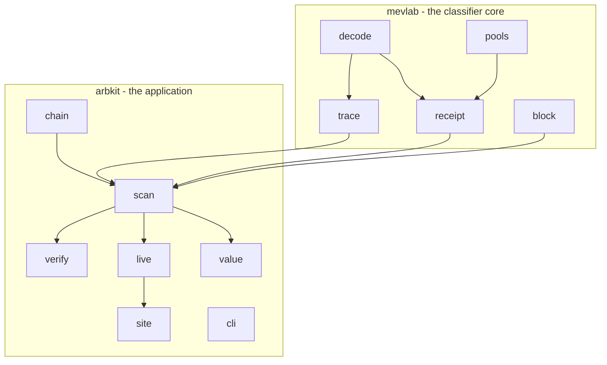

# Architecture

Two packages. **`mevlab`** is the classifier core: chain-agnostic, one package per kind of evidence it reads.
**`arbkit`** is the application around it: chains, block scanning, valuation, the live follower, the website and the
tools that check the classifier. `mevlab` never imports `arbkit`.

## mevlab: one transaction, stage by stage

| Package | Reads | Produces |
|---|---|---|
| `decode/` | receipt logs | `SwapLeg` per pool swap, `Transfer` per token movement, pool lifecycle events; every event signature in `signatures.py` |
| `pools/` | pool contracts, swaps in order | `meta.py`: which tokens a pool trades (cached); `prices.py`: pre-trade prices, price-move direction, invariant violations (exploits) |
| `receipt/` | one receipt | `classify.classify_tx` → `ArbLabel`: in six stages (gate, read events, complete legs, track prices, who gained, decide) |
| `trace/` | one call trace (+ the receipt's exact transfers) | `verdict.trace_verdict` → `TraceVerdict`: movements → operator side → quote legs → venues → legs → infrastructure → operator group → redirected outputs → other operators → payouts → verdict |
| `block/` | the block's order | trigger and position: backrun, top of block, top of flashblock, mid-block |

The event layer proposes, the trace layer verifies. The trace layer reads no Swap events and no DEX registry, so a
disagreement between the two is evidence about one of them.

## arbkit: the application

| Package | What it does |
|---|---|
| `chain/` | `spec.py` loads `chains/<chain>/chain.toml` and `dex.toml`; `settings.py` adds the RPC URLs from `.env`; `rpc.py` is the redacting RPC client; `registry.py` checks every registry address on chain; `facts.py` measures a chain's block cadence, fees and ordering |
| `scan/` | `scanner.Scanner` downloads blocks (`bundle.py`), and `block.classify_block` classifies each: event layer, then for candidates the trace verdict applied to the row (`trace.apply_trace`: structural exclusions, the verdict, embedded cycles, payments), venue checks (`venues.py`), sandwiches (`sandwich.py`), positions (`positions.py`) and other families (`families.py`, `liquidity.py`) |
| `value/` | Binance 1-minute prices (`pricing.py`), fees per chain family (`fees.py`), proceeds after costs (`proceeds.py`), builder economics (`builders.py`), per-day accounting (`daily.py`, `econ.py`) |
| `live/` | `follower.py` classifies every new block of a chain into its SQLite store (`store.py`): rows, blocks, hourly and daily totals, money audits; `status.py` reports lag and gaps |
| `site/` | the website: `http.py` (pages, static files, caching), `api.py` (one function per JSON endpoint), `seo.py` (server-rendered heads, sitemap), `reports.py` / `live.py` (a chain's data from saved reports or the live store), `views.py` (the public form of a row), `learn.py` (articles from `content/learn/`) |
| `verify/` | hand labels and hand review, audits that rebuild every fee and cycle amount from raw receipts, recall and bracket screens (what the classifier might miss), explorer copies, per-transaction evidence and block proofs |
| `cli/` | `parser.py` (every command and option), `commands/` (one handler per command), `main.py` |

## Data on disk (not in the repository)

| Path | What |
|---|---|
| `data/<chain>/` | block, receipt and trace cache; pool metadata cache; Binance prices under `data/prices/` |
| `reports/<chain>/` | saved scan reports (JSON + CSV) |
| `live/` or `$ARB_LIVE_DB` | the live SQLite stores |
| `chains/<chain>/handlabels.json`, `chains/<chain>/validation/` | hand-verified transactions and validation evidence, kept locally |
